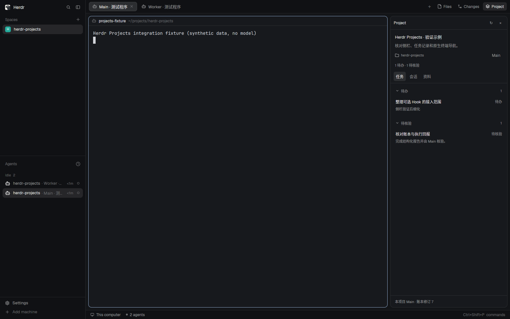

# Herdr Spaces

0.4.4 优先使用 Herdr Core 原生子终端、状态、消息和导航。升级与边界见 [原生集成说明](docs/native-core-integration.md)。

Herdr 的原生项目侧栏，以及由本项目 Main 维护的持久账本。每个 Project 有且只有一个稳定 Main 身份；Main 和 Workers 运行在 Pi、Claude Code、Codex 等现有终端界面中。没有新的聊天界面。



截图来自隔离的真实 Herdr 窗口；合成测试数据，未调用模型。

- **任务**：待办、待执行、进行中、待核验、已完成；待办提升为任务保留 id 和来源，任务可带步骤、依赖与证据。
- **会话**：定位本项目 Main 和 Workers。终端的 idle / done 不会把任务标成完成。
- **成果**：pm.md、决策、研究包与带来源/版本的产物；区分核验、采用和当前有效性，支持正文搜索、来源及版本阅读。
- 面板获得键盘焦点后，`1 / 2 / 3` 切换标签，方向键选择记录，Enter 打开，Esc 返回，`r` 刷新。
- SQLite 保存项目、执行、账本版本、回报去重和修改记录。关闭窗口、结束 Worker 或重启 Main 不会清空项目。
- **项目归属机器**：账本、pm.md、产物、Main 和 Workers 都留在项目所在机器。桌面侧栏通过 Herdr 已有机器连接读取，不复制或同步另一份账本。
- **PM 绑定与交接**：右键左侧 Agent → 设置 / 重新绑定 PM，选择或创建项目，也可确认重新绑定现有 PM。保留 Main 身份与项目记录，旧 PM 凭据失效。目标机器缺少对应项目运行程序时，设置流程自动准备或升级。
- **PM 引导配置**：指定 PM 后激活 `herdr-spaces-setup`，由该 PM 询问是否开始。用户同意后检查环境、推荐团队、确认方案并验证；暂缓和交接保留答案与草案。
- **持续协调**：结构化回报与持久收件箱同事务保存；项目机器上的普通后台服务负责通知和检查点，消息通过 hc 定向送达，PM 从任务/问题/成果读取待办，不再逐条确认信箱。消息送达不等于任务完成。
- **角色团队**：开发 / 研究 / 混合模板，支持 Pi、Claude Code、Codex、OpenCode 和 Feynman；可选 Coding Hub 路由。写任务默认 worktree 隔离，研究输出保存在持久目录。
- 基础功能无需后端 Hooks。启动指令交代维护协议，Main 显式调用项目 CLI；自动压缩/恢复注入可另行适配。

## 安装

项目机器需要 Linux 或 macOS、Python 3.10+ 和 `hc`；桌面机器还需要支持远程 `exec({on})` 的 Herdr App。验证版本为 Herdr App 0.1.14 / hc 0.1.19。运行没有 pip/npm 依赖；Node 仅用于开发测试。新团队配置支持 Worker worktree 隔离和 Coding Hub 角色/路由预设；旧配置在后续派发写任务时也使用独立 worktree，已运行的任务目录保持不变。真实模型与研究检索能力须按目标机器验证。

```sh
git clone https://github.com/DylanLIiii/herdr-spaces.git
cd herdr-spaces
python3 scripts/install.py
herdr-app check ~/.config/herdr-app/mods/project
herdr-app check ~/.config/herdr-app/mods/projects-tabs
herdr-app check ~/.config/herdr-app/mods/projects-agents
herdr-app check ~/.config/herdr-app/mods/project-setup
herdr-app do layout.switch '{"name":"projects"}'
```

安装器复制独立运行程序到 app home，安装 `~/.local/bin/herdr-project`，创建个人 `projects` 布局，以及侧栏、Tabs、Agents 和 Leader 设置四个 mods。它不会改写内置 mods、settings、keys 或既有项目数据，也不自动切换正在使用的布局。同名目标存在时拒绝覆盖；升级预览使用 `--name projects-v2`，确认后再选择该布局。自定义名称的 CLI 为 `<name>-project`。

可指定 `--home /app/home --bin-dir /bin/path --data-home /data/path`。本机生成的安装包含绝对 Python 路径；换机器应重新运行安装器。不要直接搬运安装后的布局文件。

0.3.0 用户若遇到 `No such file or directory: 'hc'`，请按 [0.3.1 升级说明](docs/onboarding.md) 更新桌面插件；重新打开 Leader 设置时会自动修复旧远端运行程序，保留项目记录。

## 在界面中开始使用

1. 在 Herdr 中打开项目机器上的 Agent，继续使用它的原生终端。
2. 右键左侧 Agent，选择 **设置 / 重新绑定 PM…**；也可以点击 Project 空状态中的 **设置项目 PM…**。已有项目可从侧栏标题旁的 **PM 配置** 进入。
3. 选择或创建项目，确认名称、目标和目录。PM 默认使用内置指南；高级设置可选自定义 Skill。
4. 点击 **绑定 PM 并交代配置**。沿用当前终端；空闲 PM 收到配置 Skill 指引，忙碌时先保留绑定，之后再交代项目。
5. **由指定 PM 询问是否开始配置。** 用户同意后，PM 参考可用工具和 Coding Hub 推荐角色、模型、成果位置与跟进方式；确认具体方案后应用并验证。选择稍后可继续原工作，随后在同一 PM 中继续配置。

目标机器尚未安装项目运行程序时，这个设置动作会从本机安装包自动准备它；无需在服务器手动克隆仓库或输入安装命令。它使用现有 Herdr 连接，不联网下载代码、不复制账本、不修改 Agent 配置。左侧会显示 Leader 标记。

一个项目已有活跃 PM 时，界面提供进入原终端或“重新绑定到此终端…”。明确确认后切换 PM，旧终端与已有 Workers 继续运行；接任 PM 会收到完整 Skill 的读取指引。完整配置步骤、角色派发、服务恢复与研究包格式见 [PM 协调与研究成果指南](docs/coordination-guide.md)；绑定与交接的底层机制见 [PM 设置说明](docs/onboarding.md)。

## 项目在远端服务器

在本机安装后，通过 Herdr 的 Add machine 或 `hc machine add SERVER` 连接服务器，再按上面的界面流程指定 Leader 即可。服务器需要可用的 Python 3.10+ 和现有 hc。

也保留手动安装方式，适合管理员预装或只使用 CLI 的场景：

```sh
git clone https://github.com/DylanLIiii/herdr-spaces.git
cd herdr-spaces
python3 scripts/install.py --runtime-only
```

这一步不安装桌面 mods 或布局。它登记该服务器的 Python、CLI 和账本路径，默认登记文件为 `~/.config/herdr-spaces/runtimes/projects.json`（遵循服务器的 `XDG_CONFIG_HOME`）。服务器的 Core 环境须能找到 `python3`。

在本机按上面的完整安装步骤安装侧栏，并通过 Herdr 的 Add machine 或 `hc machine add SERVER` 连接服务器。随后可在界面指定现有 Agent，或**在服务器的原生终端中**运行下节的 create / start。侧栏跟随当前终端所属机器，自动读取对应账本；Main / Worker 导航也留在那台机器。

多个客户端连接同一台项目机器会看到同一 Main 与记录。断线时已有记录标为上次数据，重连后重新读取；不会在本机另建 Main、接管或写入备份账本。一个项目的 Main 与 Workers 当前运行在同一台机器。

如果安装使用自定义名称，两端默认使用相同 `--name`。自定义远端入口、升级和排障见 [远程接入说明](docs/remote.md)。

## 创建项目并启动 Main

```sh
herdr-project create my-project \
  --name '我的项目' \
  --goal '完成一个有明确验收标准的目标' \
  --cwd /absolute/path/to/repository

herdr-project start --project my-project --backend pi
```

支持 `--backend pi|claude|codex|opencode|feynman`，通过对应适配器传递初始上下文。是否实际接受该参数应在目标程序版本确认。也可显式传入自己的启动或恢复参数：

```sh
herdr-project start --project my-project \
  --command-json '["pi","--continue","{context}"]'
```

`{context}` 必须独立出现一次，启动器会替换为项目规则与当前记录。启动器直接传 argv，不经过 shell 拼接。恢复参数由所选 backend 自己解释；Projects 不推断哪个历史 agent session 应该恢复。

在项目机器创建可被 Herdr 收纳的项目 Space/执行 Tab；使用 `--space <local-space-id> --tab <local-tab-id>` 可以收纳到指定位置。一个 Project 可以在多个 tab 执行；不以 cwd 判断项目归属，相同目录也可以属于多个项目。

再次调用 `start` 时，已有注册 Main 会返回原终端信息，不启动第二个。点击侧栏 Main 进入已有终端。项目创建不会自动请求模型，也不配置后端 Hooks。

可用 `create --pm /absolute/existing/pm.md` 链接 coding-hub 已有的叙述记录；现有文件保持原样。未指定时在数据目录创建 pm.md。任务状态始终来自账本，不解析任意 Markdown。

## Main 如何维护

Main 启动时获得当前项目、Main 身份、会话代次、完整 PM Skill 的读取入口及 CLI 协议。通过 `skill --project PROJECT` 读取 Skill 原文，`skill --list` 列出资源，`skill --resource RELATIVE_PATH` 完整读取引用文件（这些命令都需要 `--project PROJECT`）。每次业务变化：读取记录，写入一个 JSON 请求，然后使用已读版本提交。

`worker --role worker|explore|librarian|reviewer|research|oracle` 使用项目角色配置，旧项目回退到原 SubAgent 默认值；`--backend`、`--model` 和 `--tier` 可单次覆盖。Research 使用 Feynman `deepresearch` 或带确认 benchmark 契约的 `autoresearch`。工具安装、登录及权限仍由其自身配置管理。

```sh
herdr-project show --project my-project
herdr-project apply --project my-project --revision 1 --file /tmp/request.json
herdr-project operations
```

示例请求（revision 取 `show` 的当前值）：

```json
{
  "requestId": "request-001",
  "op": "todo.add",
  "id": "work-001",
  "title": "明确第一版验收标准",
  "sourceRef": "用户提出的项目目标",
  "nextAction": "整理可验证的结果"
}
```

`apply` 只能从启动器绑定的 Main 环境使用。版本冲突时先重读；相同 `requestId` 与内容可安全重试，换内容必须换 id。完整操作字段通过 `operations` 输出，协议和状态转换见 [数据与恢复说明](docs/architecture.md)。

Main 将 todo 提升为 task 后，可在已有授权范围内派发 Worker：

```sh
herdr-project worker --project my-project --item work-001 --revision CURRENT --backend pi
```

Worker 自动获得角色、范围、验收标准、锁定配置和输入产物版本，通过 `report --file` 提交进展、问题或产物；它不能验收。Main 通过 `attention` 跟进开放事项，通过 `collaboration` 阅读关键协作依据。任务验收先 `artifact.review`，再 `item.status accepted` 并引用本任务已核验且内容未变的 evidenceRefs。

研究包发布到独立持久目录，保留计划、草稿、来源、brief 和 provenance。`artifact.disposition` 记录采用 / 暂缓 / 不采用，`artifact.followup` 创建关联成果版本的待办；核验报告不等于采用建议。完整格式见 [产物发布](docs/coordination-guide.md#研究产物发布)。

## 恢复与排障

```sh
herdr-project context --project my-project
herdr-project history --project my-project
herdr-project reconcile --project my-project
```

- 压缩、clear 或 backend resume 后缺少上下文时，显式重新读取 `context`。没有安装 Hook 时不承诺自动注入。
- 已退出的 Main 可以再次 `start`，Main id 不变，代次递增。旧代次的写入会被拒绝。
- 启动结果不明会保留预留记录。先 `reconcile`，确认旧进程锁释放且 core 不再有存活终端后才可重启。
- `hc --keep` 可能恢复成 shell。即使 shell 空闲也不视为原 Agent 已恢复；先在 Herdr 检查并关闭旧执行，再 reconcile / start。
- Worker 的恢复核对使用 `reconcile --project ID --run RUN_ID`。旧运行未明确退出之前不允许再次派发同一工作项。
- 状态与身份检查针对项目接口；拥有同一用户 shell 和数据库权限的程序不受隔离，不能把它当作安全沙箱。

## 开发验证

```sh
npm run check
npm test
python3 scripts/workflow_smoke.py --app /absolute/path/to/herdr-app
python3 scripts/native_smoke.py --app /absolute/path/to/herdr-app
```

最后一项在独立 Xvfb、core socket、app home 和数据目录中运行真实原生窗口，使用确定性测试程序验证 Main/Worker 记录，不调用任何付费模型。它要求 Linux、Xvfb 以及可运行的 Herdr App，结束后只关闭自己创建的进程。验证结果与已知限制记录在 [验证说明](docs/verification.md)。

`python3 scripts/onboarding_smoke.py --app /absolute/path/to/herdr-app` 从未安装运行程序的远端 Agent 开始，在真实窗口测试右键入口、自动准备、原生表单、既有终端绑定和受控项目说明。

`python3 scripts/remote_smoke.py --app /absolute/path/to/herdr-app` 使用三个隔离 Core，通过真实 `hc machine --via` 连接验证两个客户端读取同一远端账本、原生导航和断线重连。它在同一台测试主机模拟机器边界，不替代真实 SSH / macOS 部署验证。

`workflow_smoke.py` 使用独立 Core、账本和确定性 PM/Research 程序验证配置、后台服务重启、交接、产物核验及后续任务；可在 macOS / Linux 运行，带 `--app` 时检查真实原生窗口，Linux 需要 Xvfb。它不调用模型。

运行程序与安装器均包含在本仓库中。使用 `python3 scripts/package.py` 可生成 `dist/herdr-spaces-0.4.4.tar.gz` 安装归档。0.4.4 使用 SQLite schema 3，旧运行程序会拒绝打开升级后的库；升级前用 SQLite backup API 保存备份，保留数据路径，先安装独立预览布局。远端设置会按能力探测准备新版本。

## 许可

原创代码采用 [MIT](LICENSE)。个人布局与 tabs mod 改编自 Herdr App，遵循 Apache-2.0；详见 [第三方来源说明](THIRD-PARTY-NOTICES.md)。
