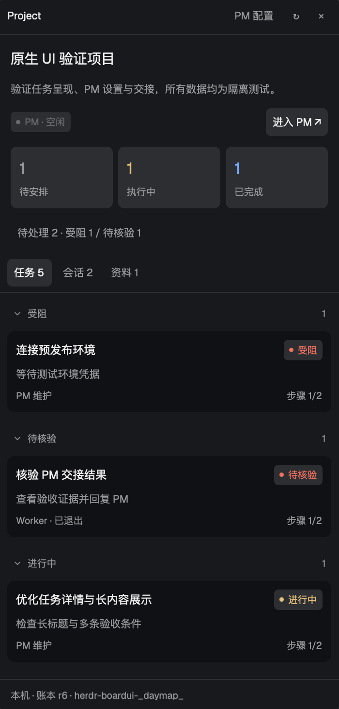
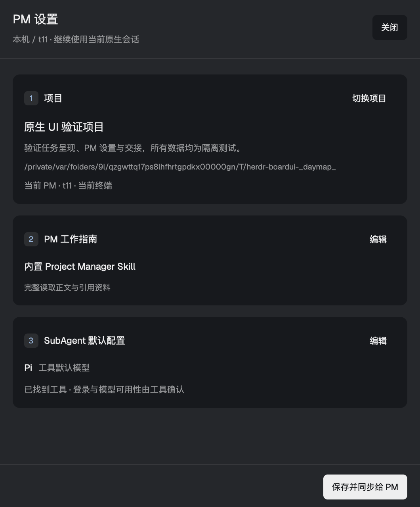
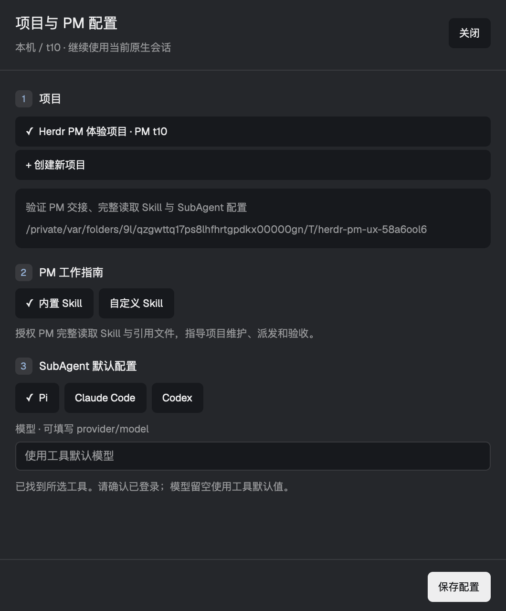
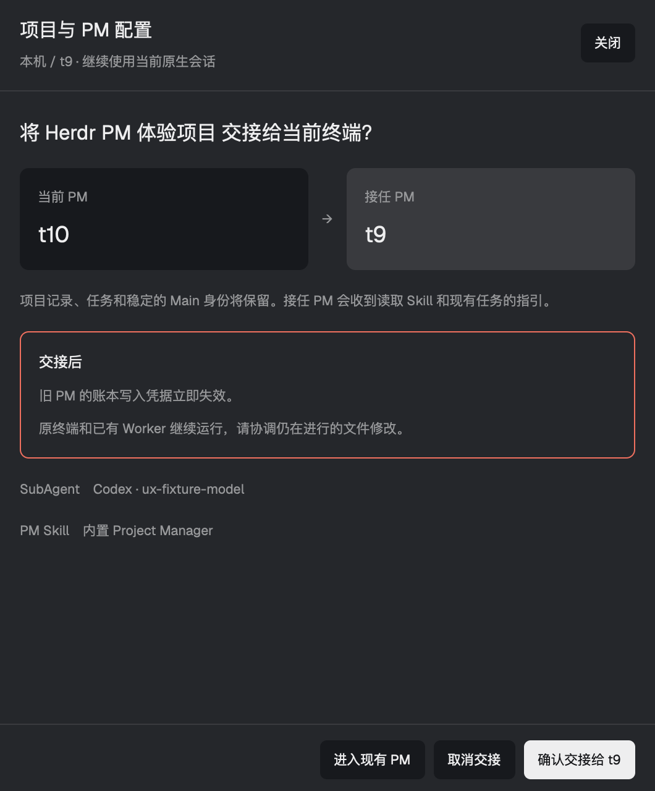
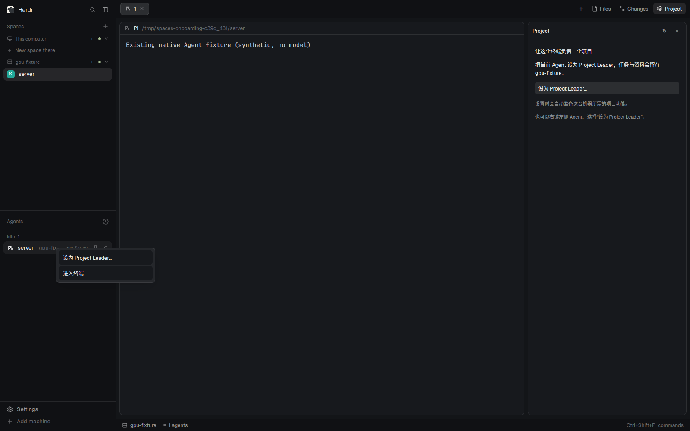
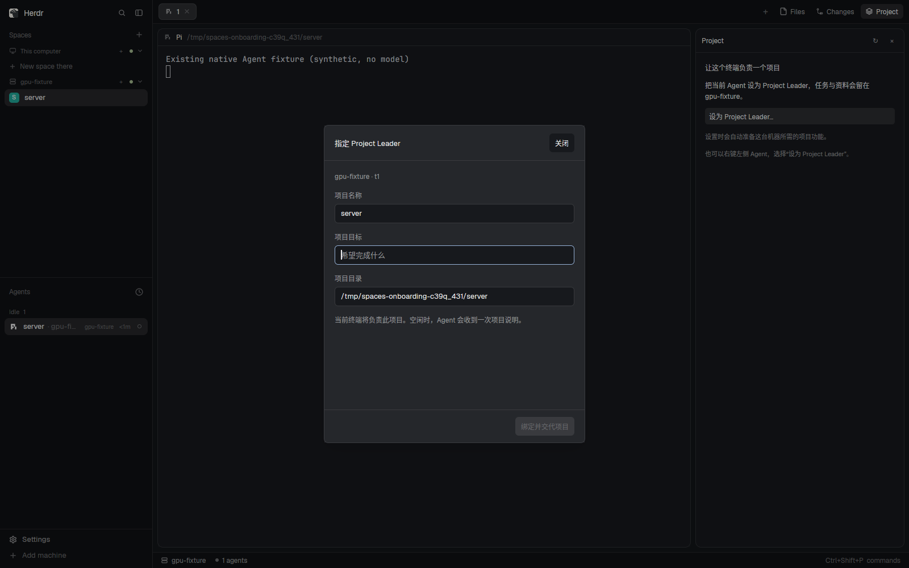

# 项目与 PM 配置

## 原生 Project 界面

Project 顶部展示目标、PM 实时状态和任务数量。“待处理”筛选受阻及待核验任务；数量来自账本，终端空闲或退出不等于任务完成。任务按处理优先级分组，完成与取消默认折叠；点击卡片查看完整标题、验收条件、步骤和执行回报。会话区可进入 PM / Worker 原终端，资料区查看证据。

已有项目打开 PM 设置时先显示当前配置，点击 Skill 或 SubAgent 旁的“编辑”展开字段。切换 Coding 工具会清空原工具的模型标识。点击“保存并同步给 PM”保存配置并发送说明；重新绑定仍需要独立交接确认。





设计参考与原生适配说明见 [native-ui-design.md](native-ui-design.md)。下面的早期截图记录上一轮界面；当前样式以上图为准。

在项目侧栏点击 **PM 配置**，或右键左侧 Agent → **设置 / 重新绑定 PM…**。窗口按“项目 → PM 工作指南 → SubAgent 默认配置”分组。默认使用内置 Skill；选择自定义 Skill 后才显示路径输入框。工具状态仅表示目标机器能否找到程序，登录和模型可用性仍需在工具中确认。



重新绑定进入独立确认页，明确显示原 PM 与接任终端，支持取消交接。保存成功后显示实际的 Skill、工具和模型，以及后续步骤；介绍发送失败时可独立重试，不重复绑定。较小窗口内正文可滚动，底部动作保持可见。



以上是 macOS 原生窗口截图的对话框裁剪，使用独立测试项目和确定性 Agent，未调用模型。

## 修复 0.3.0 的 hc 查找错误

如果设置窗口显示 `No such file or directory: 'hc'`，表示项目运行程序已经启动，但它的后台环境找不到 Core 命令。这与交互式 shell 的 PATH 可以不同；不代表服务器的 Core 没有运行。官方安装通常提供 `~/.local/bin/herdr-core`，`hc` 只是可选别名。

0.3.1 会查找并验证现有程序，支持后台 PATH、`HC_INSTALL_DIR` 和 `~/.local/bin`，也接受项目机器上的 `HERDR_PROJECTS_HC` 显式路径。不会启动登录 shell、改 PATH、安装或重启 Core。若显式指定的程序无效会报错，不静默换用另一个程序。

已按此前说明安装 `spaces-v03` 的用户，在桌面机器的仓库中执行：

```sh
git pull --ff-only
python3 scripts/install.py --name spaces-v031 --remote-name spaces-v03
herdr-app do layout.switch '{"name":"spaces-v031"}'
```

重新打开“设为 Project Leader”。它会检查原远端登记，自动切换到修复后的项目运行程序，并保留该登记的账本路径。`--remote-name` 填原布局的 `remoteName`；若原安装一直用默认 `projects`，上例改成 `--remote-name projects`。自定义 `remotes` 配置仍需保留。不要删除账本或重新创建项目来绕过这个错误。

## 为什么旧版出现安装错误

0.2 侧栏需要在目标机器找到 `herdr-spaces/runtimes/projects.json`，但把缺少登记的首次使用状态当成了普通执行错误，显示红色错误和 CLI 命令。缺少登记通常表示服务器未安装运行程序，也可能是安装名称或 Core 的 XDG 配置目录不同。它不代表项目数据丢失。

0.3 把这一步纳入用户的实际操作：在左侧 Agent 列表右键“设为 Project Leader…”，或使用右侧 Project 空状态按钮。进入设置后自动准备目标机器、列出已有项目，再绑定当前终端。

## 用户流程



截图来自隔离的真实 Herdr 窗口，使用合成 Agent 测试数据。

- 选择正在使用的 Agent 终端，右键指定 Leader。
- 选择项目或新建项目，填写名称、目标和目录；默认名称和目录来自该终端。
- 选择 Project Manager Skill：留空使用随运行程序安装的完整 Skill，也可填写项目机器上的 Skill 文件或目录绝对路径。
- 选择 SubAgent 的 Coding 工具（Pi / Claude Code / Codex），填写该工具支持的模型标识；模型留空时使用该工具默认值。工具需在项目机器上安装并完成登录。
- “绑定 PM 并发送说明”保留原生会话，为它登记唯一的 Main 身份和当前代次。
- Agent 空闲且主动报告了 app 状态时，通过 Core 的 `send --if idle` 发送一次可见的项目说明，要求它完整读取 `skill`、引用资源和 `context`，并核对 SubAgent 配置。
- Agent 正在工作、等待确认，或只是普通 shell 时，绑定成功但不发送输入。界面保留“交代项目”入口，供用户在合适时机操作。不会使用 `--force`，不会轮询后自动替用户继续。
- 发送结果不确定时不自动重发，提示查看原生终端。重复点击绑定不会重复创建 Leader 或重复发送已确认的说明。



已有其他 PM 的项目提供“进入现有 PM”和“重新绑定到此终端…”。点击后会说明旧凭据失效、终端继续运行的行为，再点击“确认交接给 <终端>”。一个 terminal 不能同时成为两个项目的 PM，也不能将已登记的 Worker 直接改为 PM。

重新绑定保留项目、Main id、任务、证据和活跃 Workers；Main generation 与 token 更新，旧终端绑定解除，旧 PM 无法继续通过账本写入接口或派发接口使用旧凭据。旧终端不会被关闭，应在交接时协调它仍在进行的文件修改。操作校验用户看到的 generation；若另一客户端已经换了 PM，当前请求被拒绝，需要重新打开设置。不能把另一个 Core 上的 PM 直接接管到本 Core。

在当前 PM 终端打开设置可更新 Skill、Coding 工具和模型。保存设置不派发 Worker；设置有变化时会重新交代配置。后续 `worker` 默认使用项目保存的工具和模型，可用 `--backend`、`--model` 单次覆盖，或者 `--command-json` 提供完整 argv。

## 完整读取 Project Manager Skill

`context` 和绑定介绍都提供项目 CLI 的绝对路径。以下命令返回原文，不使用资料预览的长度上限：

```sh
herdr-project skill --project PROJECT
herdr-project skill --project PROJECT --list
herdr-project skill --project PROJECT --resource references/subagents.md
```

自定义 Skill 的资源相对于其入口文件的目录解析。目录内的文本文件可完整读取，包括多级引用；禁止 `..` 或符号链接逃逸该目录。内置 Skill 及 SubAgent 指南随本机安装和远端自动准备一起部署。

这里提供的是明确的读取授权、全文入口和启动引导。Herdr Spaces 不修改 Pi、Claude Code、Codex 的沙箱或工具审批设置；宿主若拦截项目 CLI 或文件访问，仍需使用该宿主的权限流程放行。模型名称由 Coding 工具验证，保存配置不会测试模型 API，也不会替用户安装工具或登录。

CLI 也支持显式交接及配置（先从 `show` 获取当前 generation）：

```sh
herdr-project bind --project PROJECT --terminal NEW_TERMINAL \
  --core-scope core:CORE_ID --replace-generation 3 \
  --pm-skill /absolute/project-manager/SKILL.md \
  --worker-backend pi --worker-model provider/model
```

同一命令指定当前 PM 终端时，只更新配置，不改变 Main 身份或代次。

## 自动准备的范围

桌面安装附带匹配版本的 Python 源码包和校验值。用户进入设置时，程序经 Herdr 的目标机器连接部署这一份代码。没有另开网络服务，不从 GitHub 下载浮动分支，不安装模型或依赖包。

自动部署目录：`${XDG_DATA_HOME:-~/.local/share}/herdr-spaces/runtime/<name>/<bundle-hash>/`。登记文件仍在目标机器的 XDG config 下。已有可兼容运行程序会直接复用；旧的、可检查的登记会保留它的账本目录，切换到新版本目录，旧运行程序不会被删除。登记无效或不能检查时不会覆盖。

自动准备不改用户的 PATH、shell 配置、后端 Hooks 或已有 `herdr-project` 命令。发给 Leader 的说明包含准确的 CLI 绝对路径。需要全局命令时仍可使用手动安装器。

## 现有终端的身份

被指定的终端在账本中标记为 `mode=attached`。它的 CLI 调用通过目标 Core 的持久 id、`HC_TERMINAL_ID`、终端绑定和当前 Main 代次解析身份。受管理的启动仍使用原有环境 token；无效或过期的 managed token 不会回退成附着身份。

绑定身份和 Agent 已理解规则是两个状态。UI 显示 Leader 不代表某个模型一定已经遵守了规则。普通 CLI 外的同用户 shell 仍具有本用户文件权限，终端身份不是操作系统安全隔离。

现有会话无法在进程中途补写父进程环境变量，因此没有假装为它安装 token。绑定后由项目 CLI 在目标机器解析终端身份，启动 Worker 时再为 Worker 分配自己的 token。Agent 自己绕过启动器开的子进程可能继承父终端身份；应使用项目 CLI 的 worker 接口，不能把它当成防恶意进程的沙箱。

Attached PM 的空闲或 done 不触发退出。用户可通过明确的重新绑定操作交接仍在运行的 PM，也可在终端实际退出后使用 `reconcile` 恢复状态。恢复同一旧终端需要提供当前 generation。Managed PM 被重新绑定后，旧进程退出不会覆盖新 PM 的状态；原进程仍保留自己的原生会话。

## 从 0.1 / 0.2 更新

旧安装器拒绝覆盖，这是为了保留个人布局。可在桌面机器执行：

```sh
git pull
python3 scripts/install.py --name spaces-v03
herdr-app do layout.switch '{"name":"spaces-v03"}'
```

新布局包含自己的 Agents 和设置入口。默认账本目录不变，现有项目无需复制。远端同名 runtime 如果没有登记，首次设置会自动准备；需要读取原先自定义数据目录时，在新布局的 Project 和 Agents props 中使用一致的 `remotes` 配置（见 [远程说明](remote.md)）。不要把自定义数据目录留空后误当成原账本。

若远端仍使用原安装名 `projects`，可将新布局中 Project 与 Agents 的 `remoteName` 都设为 `projects`，自动准备会检查该登记并保留其账本路径。使用显式 `remotes.<machine>.command` 的管理员需自行更新那个入口；界面不会覆盖一个自定义命令。
