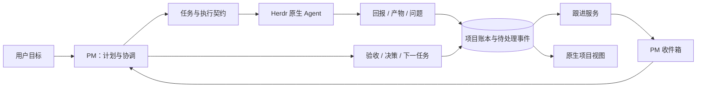

# PM 协调、Agent 配置与研究产物：设计提案

状态：供讨论的产品与工程方案；本文不表示相关能力已经实现，也不改变运行配置。

调研基线：Herdr Spaces `bbdee838b70aa63abe7c4ab7362a81e779da9bb2`；DeepSeek `dsh-superagent-prototype` `8c32a9dc5d72c033816c6a8110b37f40cf94fba4`。对照了源代码、文档、Spaces 已提交的原生截图，以及本机安装的 Coding Hub、Project Manager、Feynman Research 技能。本轮未运行 DeepSeek 服务、模型任务或新的原生窗口验证。

## 1. 产品方向

**让一个稳定的 PM 对项目结果负责，让 Herdr 承载原生执行，让 Spaces 保存并呈现目标、进展、决策和证据。**

PM 同时承担 Project Manager 和 Coordinator 两种职责。先不增加第二个常驻 LLM 协调者；增加一个确定性的跟进服务，承担持久通知、检查点、送达记录和恢复。用户继续在 PM 的原生终端表达目标，侧栏回答「项目走到哪里、什么需要我、结果在哪里」。

首次配置由用户指定的 PM 通过专用 Skill 引导。绑定后，PM 先询问是否开始配置；用户同意后才推进配置流程。UI 提供轻量绑定入口、配置状态和结果，详细的团队与工具选择由 PM 对话引导。此交互方向已由用户明确指定，本文其余未落实部分仍为设计提案。

DeepSeek 原型明确把 Main Session 限定为路由者，不做技术决策 [D4]。Spaces 的 PM 要维护里程碑、协调跨任务接口、判断研究结论和验收成果，职责更广。借鉴原型的协调机制，不能直接复制其主代理提示词。

## 2. 已有能力和真实缺口

| 方面 | Spaces 当前实现 | 建议补齐 |
| --- | --- | --- |
| 项目身份 | 一个稳定 Main id，终端绑定、代次与 token 分离，支持重新绑定 | 接任 PM 接收未处理事件和未解决问题 |
| 项目记录 | SQLite 项目记录、修订号、幂等请求、审计事件；pm.md 保存叙述 | 目标/阶段到任务的清晰展示；PM 已处理到的事件位置 |
| 执行 | WorkItem 对应多次 Run；依赖验收后才可派发 | 按角色的执行配置、工作目录隔离、执行能力适配 |
| 进度 | Worker 提交文本回报，可提交产物并进入 review | 结构化阶段、阻塞责任人、下一检查点、可靠唤醒 PM |
| 配置 | 单组 `subAgent {backend, model}`；Pi / Claude Code / Codex | 指定 PM 激活配置 Skill、开始确认、团队模板、能力检查与配置版本 |
| 产物 | 文件路径、版本、SHA-256、所属任务/Run、来源和审阅状态 | 持久保管、产物类型、研究包、来源到结论及决策的关联 |
| UI | 原生任务 / 会话 / 资料；侧栏、设置、交接流程 | 人的待办、PM 的待办、研究阅读、语义明确的状态 |

当前 `report()` 在事务中保存回报与事件，没有进一步唤醒 PM；`runtime.start()` 使用 `--no-notify`，也没有长期协调 daemon。侧栏每五秒刷新账本，只能更新展示，不能让 PM 持续推进 [L1–L4]。

当前产物是对原文件的登记，不是归档副本。文件变化会被发现，但文件删除后无法从登记记录恢复；最多登记 10 MiB 文件，预览只解码前 64 KB 为文本。图片、PDF、数据集不能被描述为已有完整浏览能力 [L1]。

## 3. 借鉴 DeepSeek 的哪些机制

| 原型机制 | Spaces 的适配 |
| --- | --- |
| Ticket 与 Assignment 分开 | 保留 WorkItem / Run；会话退出不改变任务验收结论 |
| 外部工作先写入 Effects 再执行 | 回报入账与 PM 通知入队同事务；提交后再送达 |
| 普通 progress 留在 Ticket，问题和结果通知 Main | 详细活动留在任务；需要判断、解除依赖、交付时通知 PM |
| Attention 是结构化问题 | 明确由谁回答、阻塞哪些工作；不要从自由文本猜「需要用户」 |
| Panel 先回答是否需要人 | 优先呈现用户能采取行动的事项，PM 正在处理的核验另列 |
| 配置与 prompt 有版本、来源及差异 | 角色模板可复用；每次执行记录实际配置快照 |
| 重启保存待处理输入和工作目录 | 恢复原 Run 的协调关系；核实已有执行，避免重复启动 |

原型面向 GitHub/飞书的单仓库任务，有自己的接单、订阅、PR 完成规则 [D1–D6]。第一版 Spaces 不必引入全套 Source / Trigger / Eval / Mandate 术语。先处理用户目标、Worker 回报、检查点和研究结果，未来接入 GitHub 事件时再扩展来源适配器。

原型的 30 分钟后台上限、额外并发槽位和自动合并条件也不适合作为通用默认。研究任务的检查点、资源限制和完成标准应由任务契约决定。

## 4. PM 的两种职责与跟进闭环

### 4.1 职责分配

| 承担者 | 负责什么 | 产生什么 |
| --- | --- | --- |
| PM：Project Manager | 澄清目标和验收标准、阶段与优先级、关键路径、证据判断、取舍 | 任务与依赖、决策及理由、验收结论、下一检查点 |
| PM：Coordinator | 选择角色和执行环境、派工、处理回报、协调接口、返工和交接 | Run 与任务映射、协调消息、解除阻塞、后续任务 |
| 跟进服务（普通程序） | 持久事件、通知排队/合并、检查点到期、适配执行状态、重启恢复 | 待处理事件、送达状态、明确的运行异常 |
| SubAgent | 在任务范围内执行并提供可核验结果 | 结构化进度、产物和证据 |

业务决策仍通过同一个 Store 写入路径；跟进服务不伪装成 Main，不自动采纳产物，也不根据终端 idle 推断完成。它只对协调元数据有明确的写权限。

### 4.2 最小闭环



任务简报补充少量协调信息：当前阶段、预期产物、下一动作、下一检查点；涉及等待时加 `waitingOn` 和待回答的问题。目标和验收条件继续用现有字段。

回报建议兼容扩展为：

```json
{
  "requestId": "report-unique-id",
  "kind": "progress",
  "text": "已核对事件持久化实现，正在验证恢复语义。",
  "phase": "验证来源",
  "nextAction": "对照恢复测试与实现",
  "checkpointAt": "<约定的 ISO 8601 时间>",
  "waitingOn": null,
  "artifactRefs": []
}
```

这是拟议协议，当前 CLI 尚不支持这些结构化语义。`kind` 可区分 progress / question / blocked / submitted / failed；任务状态继续沿用已有状态机，不为每种报告新增任务状态。旧报告仍可读，缺少结构化字段的记录明确显示「未提供」。

### 4.3 跟进规则

- **普通进展**：入账，更新任务摘要；合并到下一次 PM 处理批次，不为每条日志唤醒模型。
- **问题与阻塞**：先区分等待 PM、用户、依赖或环境；PM 能在已有授权内解决的直接处理。
- **结果提交**：进入 review，通知 PM；PM 阅读证据，必要时安排独立 Reviewer，再接受或退回。
- **检查点到期**：检查执行状态和最近回报，必要时请求一次状态；超时不自动等于失败，不自动重派。
- **依赖解除**：通知 PM 判断后续任务是否仍符合当前目标；只有已授权任务才推进。
- **PM 离线或忙碌**：事件保留并展示积压；到安全接收时机再交付，不强行向权限提示或正在输入的终端注入内容。

每个任务展示「最近有效进展」和「下次检查点」。执行健康、任务状态、验收状态分开表达。长实验可以一直正常运行而没有新成果；持续输出日志也不说明项目取得进展。

### 4.4 可靠性边界

先实现 `report → durable inbox → PM 读取与确认 → 协调动作`。通知只是提醒，账本中的收件箱才是恢复依据。

- 报告和待通知记录同事务提交，幂等键包含项目、Run、报告/事件 id。
- 区分 queued、sent、acknowledged、handled；`hc send` 成功只证明送达，不证明模型已读或已处理。
- PM 读取和处理使用事件 id；处理动作保留其关联，重复处理由请求幂等和当前状态检查约束。
- 后端支持幂等消息时可安全重试；只有原始 PTY 发送时，结果不明应保留 uncertain，等待读取确认或显式恢复，不能承诺 exactly-once。
- PM 交接时重新核对 generation，未处理事件归项目所有。旧 PM 无法确认新代次消息，也不能继续写业务状态。
- 服务重启后恢复待处理队列，先核对已有 Run 和终端；不把「重试通知」实现成「重启任务」。

第一版跟进服务运行在项目机器，与账本同源；可见面板的轮询继续只负责展示。关闭 Herdr 窗口后要持续跟进，需要项目机器上确实运行该服务；只实现 CLI 命令或 UI 定时器不能宣称具备这一能力。优先使用已验证的后端事件能力，缺失时用有退避的状态核对，并明确其可见性限制。

## 5. 每个用户都能完成的配置流程

### 5.1 把 Coding Hub 变成可选的团队预设

配置顺序采用 Coding Hub 的「角色 → 难度 → 执行通道与后端」。团队表示能力集合，不表示启动时同时运行全部 Agent。

| 角色 | 用途 | Coding Hub 预设 | 何时需要 |
| --- | --- | --- | --- |
| PM / Orchestrator | 项目判断和协调 | Sage；Apex 仅用于有理由的升级 | 始终绑定一个现有 PM |
| Worker | 代码与工程实现 | Craft；小改可 Breeze / Flow，复杂任务 Sage | 开发项目默认启用 |
| Explore | 本地代码定位 | Breeze，按范围调整 | 开发项目默认可用 |
| Librarian | 官方文档、API、单个外部仓库 | Craft，按任务调整 | 默认可用 |
| Reviewer | 独立核验 | Craft / Sage | 有需要时启动 |
| Research | 多来源研究、论文与实验方案 | Feynman，使用自身工作流 | 研究/混合项目启用 |
| Oracle | 证据仍不足的困难判断 | Apex，明确升级原因 | 高级选项 |

保留三种起点：开发项目、研究项目、混合项目。开发模板预置 Worker / Explore / Librarian，并提供按需 Reviewer；研究模板预置 Research / Librarian 和按需 Reviewer，实验工程可增加 Worker；混合模板合并能力。

Coding Hub 模板沿用 Pi 优先、可用 OpenCode 后备、Research 使用 Feynman 的规则。后备只处理能力缺失或明确启动失败，不因等待用户或执行结果不明而切换。Spaces 当前尚未原生支持 OpenCode 或 Feynman，需要适配并验证，不能仅在下拉框加名字。

对没有 Magpie 的用户，提供同一角色契约下的直接模型配置。`group/*` 是可选路由提供方，不应成为使用 Spaces 的前提。Feynman 是推荐研究适配器；通用产品可以允许满足同一产物契约的其它研究后端，但不能把当前 Coding Hub 预设里的 Feynman 静默替换成普通 Worker。

### 5.2 由指定 PM 激活配置 Skill

专用 Skill 暂名 `herdr-spaces-setup`，作为首次配置流程的唯一引导说明。用户先指定 PM；PM 读取此 Skill，并执行其首个动作：询问用户是否现在开始。这里的 Workflow 是 Skill 描述的可恢复流程，不要求启动多 Agent 编排引擎。

```text
用户指定 PM
  → 向该 PM 交代职责与配置 Skill 入口
  → PM 询问「是否现在开始配置？」
      → 同意：检查环境 → 补齐偏好 → 给出方案 → 应用并验证
      → 稍后：记录暂缓；用户可在原 PM 中继续
```

PM 可以这样发起：

> 我已绑定为这个项目的 PM。要现在开始配置吗？我会检查可用工具，与你确定 SubAgent 分工、模型和成果保存位置。也可以稍后继续。

询问必须来自用户指定的 PM。绑定入口只收集建立项目身份所需的信息，例如已有项目或项目名称、目录与初始目标；角色、模型、研究工具和成果目录留给 Skill 引导。先完成 PM 绑定，后完成项目配置。

用户已明确表示「开始配置」时，沿用该授权继续；不会为了流程格式重复提问。仅绑定 PM 不等于用户已经同意开始。用户选择稍后时，保持 PM 绑定和已有工作，显示「尚未配置」，不在每个回合重新催问。

### 5.3 Skill 内的配置步骤与恢复

1. **核对项目与环境**：同意开始后，读取已有目标、配置和当前终端信息，在项目机器上检查可用工具、模型/路由能力、研究检索与持久存储。复用已知信息，不让用户重新填写。
2. **逐项补齐意图**：先明确开发 / 研究 / 混合需求，再按 Coding Hub 推荐角色与默认路由。每轮询问一个有实际影响的问题，附推荐答案；只有无法从环境或已有记录确定的内容才询问。
3. **形成可审查方案**：PM 给出角色与后端分工、默认模型/路由、Skill、写入隔离、成果保存位置、自动跟进范围及未验证项。已有配置展示差异。用户确认这份具体方案后执行；已经明确确认的设置不再逐条请求确认。
4. **应用并验证**：通过版本化配置接口保存，检查回报与产物通道。协议验证使用确定性 fixture；真实模型或检索调用按已确认范围执行，缺少授权时标明尚未验证。工具登录仍在工具自身的认证流程完成，不在对话中收集密钥。
5. **交付配置结果**：PM 汇报哪些角色已可用、哪些能力待补齐、成果保存位置，以及可以开始的第一项工作。UI 从账本读取同一份结果。配置完成不自动启动业务任务。

Skill 负责询问、推荐、解释和组织步骤；项目 CLI 负责配置校验、版本冲突检查与原子保存。增加配置接口时沿用现有 Main 身份和 generation 校验，配置更新不通过重新绑定 PM 来实现。

配置状态独立于 PM 绑定状态：`待开始 → 配置中 → 待验证 → 就绪`；用户可暂缓，补齐条件后继续。保存已回答项、配置草案、下一步、Skill 版本及验证结果。中断、压缩或重新绑定后，当前 PM 读取记录续接；已确认的开始意愿与方案在适用范围内继续有效，不因会话恢复重新收集答案或重跑检查。

Skill 入口和读取方式应随绑定说明交给 PM，配套资源在项目机器可读；支持自定义 PM Skill 时也保留该入口。读取失败明确标记配置受阻，不能将已发送说明当作已激活 Skill。PM 忙碌时保留待交代状态，按安全送达机制处理；送达不明时不重复注入同一条开始询问。

当前 `onboarding.setup()` 只用 `shutil.which()` 检查工具是否存在 [L5]。建议分层显示「已安装」「账户已连接」「模型可用」「回报通道已验证」；没有探测过的层级显示未验证。不能因命令存在就给整体绿色完成状态。

UI 的首次使用入口收敛为「指定 PM」，之后展示「等待 PM 询问 / 配置中 / 已暂缓 / 待验证 / 就绪」等可理解状态，并提供「进入 PM」「继续配置」入口。继续配置交回同一个 PM 和配置记录。完成后展示团队摘要与能力状态，高级配置保留查看和编辑入口，使用相同的版本化接口，避免形成另一套配置事实。

### 5.4 配置模型与执行快照

建议将三个层次分开：

- **用户模板**：角色、路由偏好、Skill 组合和默认产物契约，可导出复用。
- **机器绑定**：实际可用后端、模型目录、工具能力和持久存储位置；凭据留在原工具的认证系统。
- **项目覆盖**：启用角色、默认难度、写入隔离与项目级限制；单次任务可在已授权范围覆盖。

每次 Run 固化角色、后端、请求的路由/模型、配置 revision、Skill 版本或哈希、cwd/worktree、输入产物版本、输出根目录。模型路由若能返回实际模型就记录；不能观测时标明未知，不伪造具体模型。

Skill 文本与结构化配置分工明确：文本描述如何思考和交付，结构化配置描述如何启动、在哪执行、如何收结果。提供「查看生效说明」和配置差异；修改默认配置不静默改变正在运行的任务。

当前 Skill 读取限制在入口目录内 [L2]，而 Coding Hub 会引用其它 Skill。导入时需要解析并显式登记依赖，生成可读的版本化资源集合；不取消路径边界，也不只传本机的绝对路径给远端。第一版可随安装包提供经过整理的角色说明和模板。

**并行写入必须先实现 worktree 或等价隔离。** 当前所有 Worker 使用项目 cwd [L3]，增加角色数量与并发不能解决这一限制。未具备隔离时保持单写手；只读研究可以共享 checkout，研究输出使用各 Run 独立目录。

## 6. SubAgent 产物与 Research 的管理

### 6.1 管理结果的生命周期

推荐关联链：

```text
目标 → 任务 → Run → 产物版本 → 审阅记录 → 项目决策 → 后续任务/实验
                       ↓
                  来源与适用条件
```

业务任务仍由现有账本统一管理。Research 不另建一套竞争的项目任务表；其内部计划和实验记录作为产物保存。

给现有 artifact 增加可选类型，例如 research / code-change / test-result / dataset-manifest / design。短报告仍可登记单文件，复杂研究登记一个有清单的产物包。

研究包最少回答：研究什么、结论是什么、证据在哪里、结论适用于哪些条件、尚不确定什么、建议下一步做什么。

### 6.2 Research 契约

| 阶段 | 要交付什么 | PM 如何判断 |
| --- | --- | --- |
| 研究简报 | 待支持的决策、范围、时间边界、已有资料、停止条件 | 研究是否会影响下一步行动 |
| 计划与收集 | 搜索/阅读范围、来源、排除理由、阶段进展 | 是否仍围绕问题，是否需要调整范围 |
| 证据核对 | 关键结论到来源段落/页码/代码 commit 的对应 | 来源是否真正支持结论，适用条件是否吻合 |
| 交付 | 最终 brief、局限、provenance、必要数据/实验记录 | 是否足以做决定或设计最小验证 |
| 转化 | 采用/暂缓/否决及理由；后续实验或实现任务 | 结果是否进入项目工作 |

按 Feynman 的现有契约，保留 `.plans`、未引用草稿、引用稿、最终 brief、provenance；Autoresearch 另外保留基线、命令、配置、指标、seed、所有尝试及 keep/revert/failed 记录 [S3]。收敛为一个 Spaces 产物包时保留这些文件与关联，不要求研究者为了适配 UI 丢弃过程证据。

检索、初稿、核对引用、待审阅可以作为研究阶段，不显示没有依据的百分比。「发现不值得采用」和「假设未获支持」也可能是成功交付；要区分执行失败、证据不足和负面研究结果。

### 6.3 产物保管与版本

建议在项目机器上设置唯一的 `artifactRoot`，默认位于现有外部数据根的 `projects/<project-id>/artifacts/`。已有 Coding Hub `reports/` 可作为显式选择的规范位置；不要暗中维护两份同步目录。

```text
<artifactRoot>/<task-id>/<run-id>/
  work/                       # 可变的研究过程文件
  published/v1/
    manifest.json             # 文件清单、哈希、来源执行与输入版本
    brief.md                  # 用户首先阅读的结论
    provenance.md
    evidence/                 # 来源定位、笔记及可合法保存的材料
    process/                  # 原计划、草稿、核对与审阅记录
    experiments/              # 有实验时才存在
```

上述是建议的包装结构，Feynman 的原始目录可以通过 manifest 引用或原样收纳。由发布步骤生成新的不可变版本，保留旧版本；代码改动留在各自 worktree/分支，以 commit/diff 关联，不把代码成果搬成散乱副本。

文件登记升级为：受管产物发布到持久目录、计算哈希并提交清单，全部成功后再入账。发布中断可重试或留下明确未完成记录，不出现账本已登记但清单缺文件的假成功。旧的路径登记继续兼容，并标注为「外部引用」。

大数据、模型权重和媒体保持在可访问的持久存储，账本登记有界清单、稳定位置、大小、内容标识与检查状态。10 MiB 是当前登记文件的限制，不能通过把超大文件当普通文本放宽预览来处理。清理 worktree 或终端前应保证已提交产物仍可访问；产物保留与删除独立于 Run 生命周期。

远端产物继续由项目机器提供读取。客户端缓存只是缓存，不产生第二本账；离线显示最后读取时间。后续若支持跨机器 Worker，产物 locator 必须增加机器/存储身份，不能把远端绝对路径当成本机路径。

### 6.4 证据、验收与采纳分开

现有 `artifact.status=accepted` 表示 PM 已核验，而 UI 使用「已采纳」[L4]。研究场景必须拆清：

- **审阅结论**：待核验 / 已核验 / 需修订。
- **项目处置**：采用 / 暂缓 / 不采用，附理由和关联决策。
- **内容有效性**：当前 / 可能过时 / 已被替代。

一份严谨证明某方案不适合的研究可以被验收，方案则不采用。哈希只证明内容完整性，不能证明研究结论为真。

第一版只结构化记录会影响决策的关键结论：`claim → source locator → verification note → limitation`。普通小报告保留 Markdown 即可，不要求每句话成为数据库实体。先提供元数据与文本检索；语义索引可以以后加入，而且不应成为事实来源。

创建新研究任务时，PM 先检索已有报告并锁定所使用的版本。引用关系进入任务输入与决策。来源变更或适用条件失效时提示复核，不自动重写既有结论。

## 7. UI / UX：执行与阅读分别优化

现有原生深色主题、任务分组、键盘导航和设置摘要值得保留。对照已提交截图与 `mods/project/main.js`，主要问题是顶部摘要和数量卡占据较多空间，受阻与待核验缺少明确的下一责任人，资料列表以文件路径为主。此处是基于现有实现与截图的设计判断，尚未经新方案可用性测试。

### 7.1 三个稳定入口

保留现有位置与 1/2/3 导航：**任务 / 会话 / 成果**，将「资料」升级为更有结果含义的「成果」，其中仍能找到项目说明、决策和原始文件。

任务首页顶部按以下顺序：

1. 项目名、当前阶段、PM 的一句当前判断。
2. **需要你**：只显示有明确用户动作的问题，每项给出建议和等待它的任务。
3. 紧凑项目状态：进行中、待 PM 核验、后续任务；点击后数量与列表严格一致。
4. 按阶段/状态分组的真实任务。

「需要你」来自结构化问题的收件人，不能用 `blocked + review` 代替。PM 能自行核验的结果显示「PM 正在核验」；只有确实需要用户判断的才要求用户处理。

任务行主要呈现标题、阶段/等待对象、最近有效变化。工具、模型和终端 id 在详情；一次点击仍可进入原生执行终端。任务详情展示目标、下一动作、验收标准、成果和关键时间线；完整工具日志留给终端。

### 7.2 示意内容

以下是设计示例，不是当前项目状态：

```text
Herdr Spaces                         进入 PM ↗
当前阶段：研究闭环
PM：已形成建议，等待存储位置决定后验证。

需要你 · 1
研究成果保存在哪里？
推荐：项目机器的持久目录
[使用推荐]  [选择位置]

任务            会话            成果

进行中
实现任务回报通知
Worker · 验证恢复行为 · 2 分钟前更新

待 PM 核验
DeepSeek 协调机制分析
Research · 引用核对完成 · 阅读成果 ↗
```

这些操作须通过明确的语义命令和既有身份/修订检查实现。当前面板以只读浏览为主；示例按钮不表示已有 API，也不意味着给 UI 任意执行命令的能力。

### 7.3 研究阅读

侧栏适合看结论和列表，长报告需要较宽的原生阅读面。先以 Markdown 完成首个阅读闭环，再验证 Herdr mod 提供的扩展视图能力；不假定已经有 PDF、图片标注或全功能文档编辑器。

成果详情首先展示一句结论、审阅状态、适用条件及「影响哪些决策」。正文之后是来源、过程文件和版本历史。点击引用可到 URL、页码、代码版本或笔记位置；当前来源不可访问时明确提示。

理想操作是「阅读研究 → 看关键证据 → 请 PM 验证建议」。这个操作先创建有来源的待办，由 PM 细化或复用已有任务，避免一键重复启动研究或执行。

### 7.4 视觉与交互约束

- 沿用 Herdr 语义色和原生控件；状态以文字配合颜色，不靠发光、闪烁或持续动画吸引注意。
- 减少顶部独立大卡片，以信息层级、留白和轻分隔表达关系。正常健康状态不反复提示。
- 保留现有 4px 间距体系；阅读正文应大于辅助标签，并验证中英文、长标题和放大后的可读性。
- 侧栏宽度不足时展开单项详情，不放横向多列看板；报告阅读宽度可调。
- 首次使用只要求用户指定 PM；由该 PM 通过配置 Skill 询问是否开始，再逐步引导。UI 展示进度、草案和结果，保留进入 PM 与继续配置的入口。
- 后续高级配置只有发生改动才强调保存；保留未保存内容、错误定位、返回和键盘焦点。
- 更新不抢焦点、不跳滚动位置；断线显示数据时间与恢复入口，不能把缓存当实时状态。
- 首轮视觉验证覆盖空项目、正常工作、用户问题、等待 PM、失败、离线、长内容、浅/深主题和窄窗口；实际确认键盘路径与可访问名称，不以支持快捷键等同完整无障碍。

## 8. 按依赖实施

| 阶段 | 交付 | 主要落点 | 完成判据 |
| --- | --- | --- | --- |
| A：可靠跟进 | 结构化回报、持久 PM 收件箱、处理确认、检查点、项目机器跟进服务 | `store.py`、`runtime.py`、`cli.py`；新增协调模块；PM 协议 | PM 忙碌/退出/交接及服务重启后不丢回报、不重复启动任务；能区分未送达与未处理 |
| B：PM 引导配置与团队 | 配置 Skill、开始询问与暂缓/恢复、模板、角色配置、能力检查、Run 配置快照、写任务隔离 | 配套配置 Skill；`manager.py`、`onboarding.py`、`runtime.py`、`mods/project-setup/` | 指定 PM 先询问是否开始；暂缓后可恢复且不重复询问；新用户能完成配置和 Worker 闭环；并行写互不覆盖 |
| C：研究闭环 | Feynman 适配、产物包发布、关键证据、审阅与采纳区分、后续任务关联 | 新增产物/后端适配模块；Store 与 CLI；`mods/project/` | 一份研究从简报到验收、决策、后续任务可追溯；清理执行目录后已发布成果仍能读 |
| D：体验完善 | 人的待办与 PM 待办、成果阅读、搜索、版本/来源导航 | `mods/project/`、`mods/project-setup/`、原生验证脚本 | 用户能迅速找到当前问题、正在做什么、已有结果，且每个数量都能追到记录 |

A 阶段同时做最小的待处理状态展示，C 阶段同时做基础阅读；D 是体验完善，不把可观察性拖到最后。更丰富的里程碑视图、跨机器 Worker、GitHub/飞书接单和语义检索延后。

不需要重写现有账本为完整事件溯源系统。保留 Project / WorkItem / Run / Artifact / Decision；增量加入角色配置、协调队列和产物关联。数据库与远端协议升级必须有迁移、版本协商及旧版本拒绝行为；现有客户端遇到新增能力能明确解释，而不是静默忽略字段。

### 首次配置验收场景

用户指定 PM 后，由该 PM 读取配置 Skill 并询问是否开始。测试「稍后」时保留绑定、不推进配置、不反复催问；测试「开始」时复用已有信息，只询问缺失项，生成具体方案并按确认内容应用。模拟中断和 PM 交接，确认草案与已回答项保留、旧 PM 无法继续写入；验证结果按实际能力显示，保存成功与配置就绪分别呈现。当前提案未实现此 Skill 或相应状态协议。

### 第一条端到端验收场景

完成配置后，用「研究 dsh-superagent 对 Spaces 的价值」作为产品自己的样例：

1. PM 定义要支持的决策与验收要求，选择研究角色；示例测试用 fixture，不自动消费模型预算。
2. 执行者报告「分析机制 → 核对来源 → 形成建议」，写入持久产物目录。
3. 让 PM 暂时忙碌并重启跟进服务，确认回报仍存在且未重复派工。
4. PM 接收结果，核验关键来源，将某建议标为采用、另一建议标为暂缓，并创建带来源的后续任务。
5. 重新绑定 PM，检查原任务、待处理事项、产物版本和决策仍可读；旧 PM 的写入被拒绝。
6. 结束执行并移除测试执行目录，确认已发布报告仍可打开；桌面断开再连接后仍指向同一本远端账本。

优先验证这条闭环，再扩大角色数量和自动化程度。衡量重点是回报是否丢失、是否重复派发、结果能否追溯、配置能否自助完成、需要用户处理的事项是否准确；不以 Agent 数量、token 数或文件数量代表项目进度。

## 9. 证据来源

### DeepSeek 原始资料（固定 commit）

- [D1：README，原型声明与定位](https://github.com/deepseek-ai/dsh-superagent-prototype/blob/8c32a9dc5d72c033816c6a8110b37f40cf94fba4/README.md)
- [D2：Philosophy，人的注意力与安静默认](https://github.com/deepseek-ai/dsh-superagent-prototype/blob/8c32a9dc5d72c033816c6a8110b37f40cf94fba4/docs/000-philosophy.md)
- [D3：Domain，Ticket / Assignment / Attention](https://github.com/deepseek-ai/dsh-superagent-prototype/blob/8c32a9dc5d72c033816c6a8110b37f40cf94fba4/docs/001-domain.md)
- [D4：Prompts，Main 的职责与配置版本](https://github.com/deepseek-ai/dsh-superagent-prototype/blob/8c32a9dc5d72c033816c6a8110b37f40cf94fba4/docs/004-prompts.md)
- [D5：Execution，后台执行、重试与恢复](https://github.com/deepseek-ai/dsh-superagent-prototype/blob/8c32a9dc5d72c033816c6a8110b37f40cf94fba4/docs/003-execution.md)
- [D6：Panel，信息架构与状态原则](https://github.com/deepseek-ai/dsh-superagent-prototype/blob/8c32a9dc5d72c033816c6a8110b37f40cf94fba4/docs/005-panel.md)
- [D7：Effects 实现](https://github.com/deepseek-ai/dsh-superagent-prototype/blob/8c32a9dc5d72c033816c6a8110b37f40cf94fba4/src/app/effects.ts)
- [D8：Notices 实现，reportRelay](https://github.com/deepseek-ai/dsh-superagent-prototype/blob/8c32a9dc5d72c033816c6a8110b37f40cf94fba4/src/app/notices.ts)
- [D9：SETUP，先探测、推荐默认、只问缺失项](https://github.com/deepseek-ai/dsh-superagent-prototype/blob/8c32a9dc5d72c033816c6a8110b37f40cf94fba4/SETUP.md)

### 本仓库证据

- L1：[store.py](../herdr_projects/store.py)：`report`、`add_artifact`、`read_artifact`、`operation`。
- L2：[manager.py](../herdr_projects/manager.py)：单组 SubAgent 配置、支持后端、Skill 资源边界。
- L3：[runtime.py](../herdr_projects/runtime.py)：`context`、`start`、`execute`、`reconcile`。
- L4：[Project mod](../mods/project/main.js)：顶部摘要、资料标签、产物状态文案、文本预览和刷新。
- L5：[onboarding.py](../herdr_projects/onboarding.py)：工具发现、PM 绑定、说明送达状态。
- [架构说明](architecture.md)、[现有视觉规范](native-ui-design.md)、[项目截图](native-ui/project.png)、[设置截图](native-ui/settings.png)。

### 本机技能契约

以下为调研时安装版本的行为约定，路径用于溯源；不代表所有用户都安装了这些技能。产品模板应打包明确版本，不运行时依赖这些个人路径。

- S1：`~/.pi/agent/skills/coding-hub/SKILL.md`：角色、五档路由、端点、一个分支一个写手、Feynman 研究例外。
- S2：`~/.pi/agent/skills/project-manager/SKILL.md` 及 `references/research-mindset.md`：基于证据推进、关键路径、外部报告与决策转化。
- S3：`~/.pi/agent/skills/feynman-research/SKILL.md`：Deepresearch / Autoresearch 的计划、草稿、引用、provenance 和实验记录。

本文的研究产物包、关键结论关联、团队模板及 Spaces 跟进服务是针对本项目提出的设计，不是对 DeepSeek 原型已有能力的宣称。
