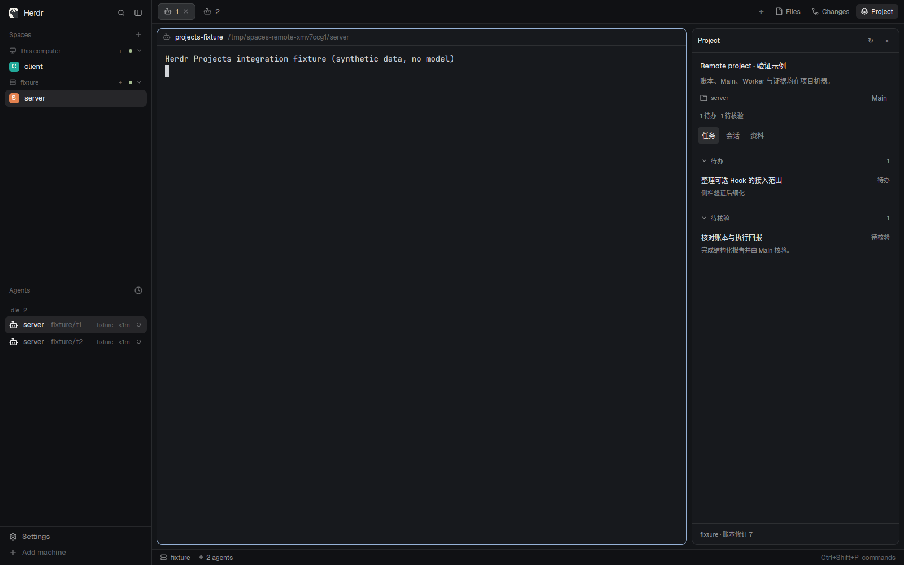

# 项目归属机器与远程接入

当前边界是：每个项目的账本、pm.md、资料、Main、Workers 及执行锁均位于项目所在机器。同机可以有多个项目；多个桌面客户端可以连接同一机器。桌面侧栏只在内存中保留当前展示数据，不同步数据库，也不自动接管失联项目。

## 安装与连接

本机使用完整安装器。0.3 中，右键现有 Agent 的“设为 Project Leader”流程会自动准备服务器运行程序；也可预先使用 `python3 scripts/install.py --runtime-only`。自动准备使用桌面附带的匹配源码包，并通过 Herdr 已有机器连接通信；项目接口不额外监听公网端口。Core 身份、SSH 认证、机器连接由 Herdr 管理。

远端安装登记位于 `${XDG_CONFIG_HOME:-~/.config}/herdr-spaces/runtimes/<name>.json`，包含协议版本和该机器的 argv。侧栏通过 `exec("python3", [...], {on: machine})` 读取登记并执行项目 CLI。程序与路径作为独立参数传递，不拼接 shell 字符串，也不会拿本机的 Python / app home 路径在远端执行。

项目的创建/绑定在设置窗口中完成，或从项目机器原生终端使用 CLI；Main 的结构化操作和 Worker 回报仍在项目机器执行。可以使用本机或 SSH 中的终端，也可以使用 Herdr 展示的服务器终端；它们必须连接项目使用的同一个 Core session。侧栏浏览只读取 snapshot / read，读取与刷新不会启动 Agent。Leader 设置是明确的用户动作，自动安装与受控介绍仅在该流程中执行。

## 自定义入口

默认两端使用相同的安装名称（`projects`）。个人布局文件的 Project mod `props` 可以按机器覆盖。以下片段放在安装后的 `layouts/<name>.json` 的 Project content.props 内，保留安装器已有的本机 python / entry / dataHome 字段：

```json
{
  "remoteName": "projects",
  "remotes": {
    "gpu-dev": { "name": "spaces-v02", "python": "/usr/bin/python3" },
    "other-server": {
      "command": ["/home/user/.local/bin/herdr-project"]
    }
  }
}
```

桌面使用新安装名称时，`--remote-name ORIGINAL` 可让 Project 和 Agents 继续使用原远端登记，避免手动修改两个 props。Leader 设置会检查登记的能力，必要时更新旧运行程序，同时保留其账本路径。

`remotes` 的 key 是本客户端 Herdr 的 machine 名称，仅用于找到连接，不是项目身份。`command` 是完整 argv；也可包含 `--home` 和自定义账本目录。`--registry-dir` 自定义安装登记目录时，使用显式 `command`；默认发现只读取目标 Core 的 XDG config 目录。

安装器不会覆盖已有文件。0.1 用户可以在两端以 `--name spaces-v02` 并行安装，再选择本机的 `spaces-v02` 布局。默认数据目录仍为 `herdr-projects`，无需复制数据库。项目侧命令变为 `spaces-v02-project`。已经运行的 0.1 Main/Worker 仍使用原运行程序；待原生会话正常退出并完成核对，再由新 CLI 启动下一代 Main。

## 身份与重连

新执行使用目标 Core 返回的持久 id 作为 scope：`core:<id>`。它不依赖客户端别名或 socket 路径拼写。0.1 的原环境 scope 作为精确匹配的兼容入口；不把另一个 socket 自动当成旧的 default session。旧记录未匹配时应在原 Core 环境完成核对，再从新 CLI 启动下一代 Main。遇到多个可能的终端绑定则报错，不选择其中之一。

远端账本只保存本地 terminal id，例如 `t1`；界面导航时才加当前客户端的机器前缀，例如 `gpu-dev/t1`。查看跨机器 peek 时使用实际终端的机器，不能只看背景 Space。来自其他 Core 的执行记录不会跳到同名终端。

每份 snapshot 附带协议版本、Core scope 和账本路径。资料读取要求来源仍与 snapshot 一致；Core 或账本切换后必须刷新。切换机器、项目或关闭面板之后，迟到的读取结果会被丢弃。远端读取失败只显示错误和上次记录，不回退到本机账本，不把任务标成完成，不重启 Main。

## 排障

- 目标机器未准备：使用 0.3 的“设为 Project Leader”入口自动准备，或手动 runtime-only 安装；确认使用的安装名称和数据目录一致。
- 找不到 Python：检查服务器 Core 环境的 `python3`，或在远端 props 中指定绝对 `python` 路径。
- 找不到 `hc`：0.3.1 起无需后台 PATH 含 `~/.local/bin`，运行程序会发现官方 `herdr-core` / `hc` 安装。先更新桌面插件并重新打开 Leader 设置，以升级旧远端运行程序。非标准路径可在项目机器设置 `HC_INSTALL_DIR` 或 `HERDR_PROJECTS_HC`；不要因此重启 Core 或删除项目。
- 终端未关联项目：确认 Main 通过项目 CLI 启动，并且 CLI 和当前机器连接使用同一 Core session、同一账本目录。
- 运行程序版本不兼容：升级项目机器的运行程序；旧版本不能靠新增一个客户端配置来获得新协议。
- 无法读取或跳转：先检查 Herdr 的机器连接；不要因为失联而创建第二个项目副本。项目端可运行 `herdr-project probe` 查看程序版本与数据目录。
- legacy binding 歧义：检查原 Core 和账本归属，不手动删除数据库记录来绕过检查。

## 验证边界



本机 18 项、远程 16 项原生集成检查和 53 项自动化测试通过，详见 [验证记录](verification.md)。截图为真实窗口中的合成测试数据。

自动化测试覆盖按机器读取、同名终端、跨机器 peek、迟到响应、离线记录、协议不兼容和资料来源变更。原生集成脚本使用真实 Core 的 machine 连接及 exec，三个隔离 Core 位于同一 Linux 测试主机；没有连接用户的服务器，也没有验证真实 SSH 登录、macOS 窗口或跨主机文件系统隔离。项目的 Worker 跨多台服务器派发不在此版本范围内。
